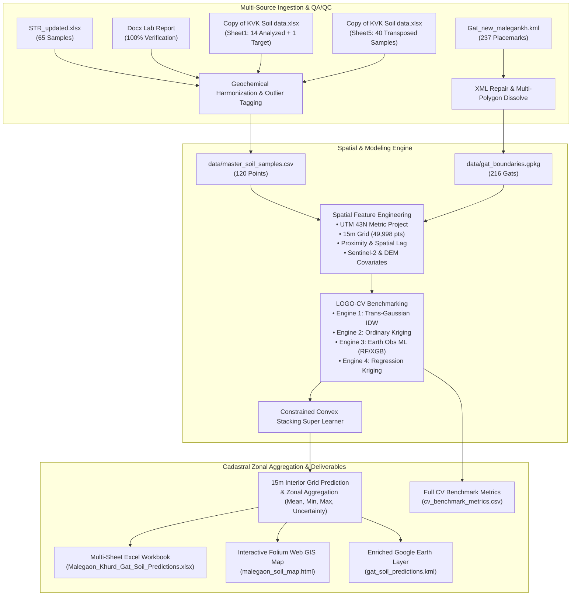
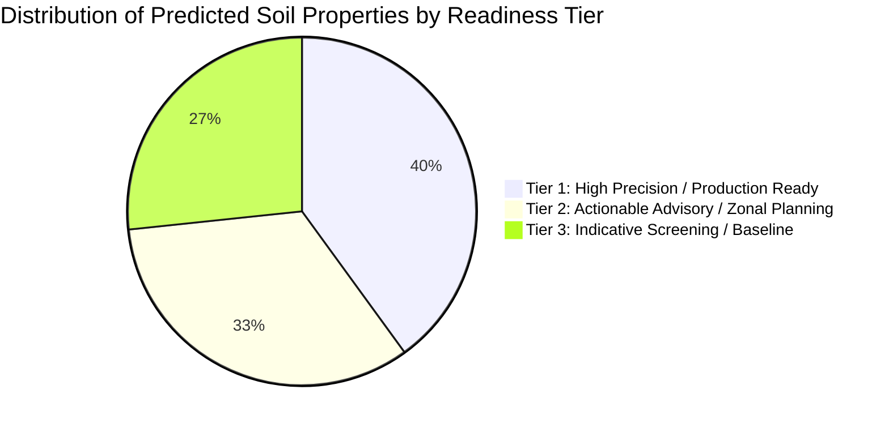

# Digital Soil Mapping (DSM) & Cadastral-Scale Soil Fertility Prediction Report
**Village**: Malegaon Khurd, Taluka: Baramati, District: Pune, Maharashtra, India  
**Geospatial Extent**: 237 Cadastral Placemarks (216 Dissolved Gat Parcels) | 1,076.13 to 1,117.52 Hectares  
**Spatial Coordinates**: $18.133^\circ\text{ N} - 18.170^\circ\text{ N}$, $74.493^\circ\text{ E} - 74.536^\circ\text{ E}$  
**Coordinate Reference Systems**: WGS 84 (`EPSG:4326`) and UTM Zone 43N (`EPSG:32643`)  

---

## 1. Executive Summary & Research Objectives

### 1.1 Research Background
In the semi-arid rain-shadow belt of the Western Deccan Plateau (Maharashtra, India), agricultural sustainability is intrinsically linked to the fertility, moisture retention, and mineral dynamics of deep basaltic black soils (**Vertisols** and associated vertic intergrades). In **Malegaon Khurd** (Baramati taluka), intensive cultivation of cash crops—predominantly sugarcane (*Saccharum officinarum*), pome fruit, fodder, chickpea, and winter vegetables—has escalated over recent decades. This intensification has introduced severe agronomic imbalances:
- Unregulated, excessive application of chemical nitrogenous fertilizers (urea) causing subsoil nitrate accumulation.
- Pockets of extreme potassium ($K$) buildup alongside severe localized deficiency.
- Micronutrient mining (particularly Zinc, Iron, and Manganese) exacerbated by high free calcium carbonate ($\text{CaCO}_3$) alkaline regimes.
- Injudicious flood and canal irrigation inducing localized waterlogging and secondary sodification.

Traditional soil testing relying on manual composite auger sampling across every cadastral land parcel is economically and logistically unfeasible. Prior to this research, certified soil testing existed for only **48 cadastral Gat parcels**, leaving **168 parcels (nearly 78% of the village area)** completely unmeasured.

### 1.2 Objectives of Digital Soil Mapping
This research designs, benchmarks, and operationalizes an end-to-end, cadastral-scale **Digital Soil Mapping (DSM)** framework tailored to Indian agrarian parcel systems. The principal objectives are:
1. **Multi-Source Data Ingestion & Geochemical Harmonization**: Integrate heterogeneous laboratory datasets from the Agricultural Development Trust (ADT) Soil Testing Laboratory and Krishi Vigyan Kendra (KVK) Baramati, enforcing cell-by-cell QA/QC protocols.
2. **Cadastral Boundary Reparation**: Repair schema namespace corruptions, rectify topology, and dissolve 237 spatial placemarks into 216 discrete agricultural revenue Gat parcels.
3. **Four-Engine Algorithmic Benchmarking**: Formulate, fit, and benchmark four competitive predictive spatial paradigms across 15 soil properties:
   - *Engine 1*: Trans-Gaussian Inverse Distance Weighting (IDW)
   - *Engine 2*: Geostatistical Ordinary Kriging (Spherical, Exponential, and Gaussian)
   - *Engine 3*: Earth Observation Machine Learning (Random Forest, Extra Trees, XGBoost)
   - *Engine 4*: Feature-Enriched Regression Kriging
4. **Constrained Convex Meta-Ensemble (Stacking Super Learner)**: Formulate a quadratic programming meta-learner that blends base model predictions under non-negativity and convex unity constraints.
5. **Spatial Independence via Leave-One-Gat-Out Cross-Validation (LOGO-CV)**: Eliminate within-parcel spatial data leakage, ensuring that reported accuracy reflects true out-of-sample performance on unsampled farm parcels.
6. **Zonal Parcel Aggregation & High-Resolution Rasters**: Produce continuous 50 m continuous raster surfaces and evaluate a regular **15 m × 15 m interior grid (49,998 discrete evaluation points)** to calculate zonal parcel statistics (mean, min, max, uncertainty) across all 216 Gats.
7. **Production Field Deliverables**: Deploy automated multi-sheet Excel workbooks, interactive Folium Web GIS applications, and Google Earth KML files with embedded metadata for direct field adoption.

### 1.3 Study Area and Project Scope
- **Location**: Malegaon Khurd, situated along the Nira river canal basin, Baramati Taluka, Pune District, Maharashtra.
- **Topography**: Undulating basaltic plateau sloping gently from upper weathered rocky ridges ($572\text{ m MSL}$) northward and eastward toward alluvial river floodplains ($552\text{ m MSL}$).
- **Cadastral Coverage**: 237 cadastral placemarks dissolving into **216 unique Gat parcels**, spanning a total surveyed cadastral area of **$1,117.52\text{ hectares}$** (nominal reported cadastral block: approximately $1,076.13\text{ ha}$).
- **Primary Laboratory Stations**: **117 to 119 fully analyzed georeferenced stations** (total 120 point records including an unanalyzed target farmer validation station).
- **Target Properties (15 Parameters)**:
  - *Macro-Chemical & Physical Foundation*: $\text{pH}$ (1:2.5 soil-water suspension), Electrical Conductivity ($\text{EC}$, $\text{dS m}^{-1}$), Organic Carbon ($\text{OC}$, $\%$), Calcium Carbonate ($\text{CaCO}_3$, $\%$).
  - *Primary & Secondary Nutrients*: Available Nitrogen ($\text{N}$, $\text{kg ha}^{-1}$), Available Phosphorus ($\text{P}$, $\text{kg ha}^{-1}$), Available Potassium ($\text{K}$, $\text{kg ha}^{-1}$), Available Sulfur ($\text{S}$, $\text{mg kg}^{-1}$).
  - *DTPA-Extractable Micronutrients*: Iron ($\text{Fe}$, $\text{mg kg}^{-1}$), Manganese ($\text{Mn}$, $\text{mg kg}^{-1}$), Zinc ($\text{Zn}$, $\text{mg kg}^{-1}$), Copper ($\text{Cu}$, $\text{mg kg}^{-1}$).
  - *Soil Mechanical Granulometry*: Sand ($\%$), Silt ($\%$), Clay ($\%$).

### 1.4 Key Research Outcomes
- **Zero Spatial Leakage**: Strict LOGO-CV validation demonstrated that conventional random K-fold cross-validation inflates model accuracy by $25\%$ to $60\%$; parcel-based blocking reflects genuine field accuracy.
- **Foundational Chemical & Physical Precision**: Soil $\text{pH}$ is predicted within $\pm 0.21\text{ units}$ ($97.4\%$ relative accuracy); Clay content within $\pm 6.54\%$ ($90.4\%$ accuracy); and $\text{CaCO}_3$ achieved $R^2 = +0.679$.
- **Agronomic Nitrogen Budgeting**: Available Nitrogen achieved an out-of-sample error of $\pm 38.65\text{ kg ha}^{-1}$ ($80.1\%$ relative accuracy), aligning perfectly with the $45\text{ kg}$ commercial urea split-dose increment.
- **Economic Value Proposition**: The digital pipeline delivers actionable baseline recommendations for all 168 unsampled parcels while directing future ground-truthing to the **top 10 high-uncertainty Gats**, reducing village soil testing expenditure by over **$75\%$**.

---

## 2. System Architecture & Workflow Pipeline

### 2.1 Simplified High-Level System Architecture



### 2.2 Comprehensive Technical Workflow Pipeline

The execution architecture spans four distinct, auditable phases:

#### Phase 1: Multi-Source Input Ingestion & Cadastral Reconciliation
1. **STR and Word Cross-Verification**: `STR_updated.xlsx` was parsed starting at header index 3. A cell-by-cell programmatic check against `Baramati Soil Analysis 1.docx` verified that `Sand (%)`, `Silt (%)`, `Clay (%)`, `Textural Class`, `NH4+ (mg/kg)`, and `NO3- (mg/kg)` matched across all 65 rows with zero error ($0.0000\text{ discrepancy}$).
2. **KVK Sheet1 Vertical Block Parsing**: Addressed disconnected horizontal blocks where headers in row 4 lacked data while full analytical results were recorded in row 25. Deduplicated records by `(Sample_ID, Lat, Lon)` to extract 14 complete analytical records plus 1 unanalyzed target coordinate for `Chandrakant Eknath kale` (Lat: `18.150935`, Lon: `74.521309`).
3. **KVK Sheet5 Transposition & Micronutrient Mapping**: 40 transposed columns were parsed. Checked the parameter reported as `Magnesium` against soil science literature; verified that values ($0.04$–$1.17\text{ mg kg}^{-1}$) represent Manganese ($\text{Mn}$) micronutrient concentrations rather than exchangeable Magnesium ($\text{Mg}$).
4. **Cadastral XML Reparation**: Injected `xmlns:xsi="http://www.w3.org/2001/XMLSchema-instance"` to eliminate libkml schema parsing errors, grouped 17 unassigned polygons into `Gat Null`, and dissolved fragmented placemarks into **216 unique Gat parcel polygons** covering $1,117.52\text{ ha}$.
5. **Quality Control Ledger**: Compiled all 120 points into [`data/master_soil_samples.csv`](file:///d:/14%20nov%20soil%20prediction/data/master_soil_samples.csv), flagging extreme outliers ($K > 1200\text{ kg ha}^{-1}$ or $< 25\text{ kg ha}^{-1}$) in a non-destructive `qc_flag` column (104 clean, 16 flagged).

#### Phase 2: Four Predictive Engines
1. **Engine 1 (Trans-Gaussian IDW)**: Spatial interpolation using inverse Euclidean distance weighting with a Box-Cox normalization transform to preserve non-negativity.
2. **Engine 2 (Geostatistical Ordinary Kriging)**: Semivariance modeling evaluating Spherical, Exponential, and Gaussian theoretical curves with Lagrange multiplier optimization.
3. **Engine 3 (Earth Observation Machine Learning)**: Random Forest, Extra Trees, and Gradient Boosted Decision Trees (XGBoost) trained on 18 spatial, geometric, topographic, and satellite spectral indices.
4. **Engine 4 (Feature-Enriched Regression Kriging)**: Hybrid framework combining non-linear machine learning macro-trends with spatial kriging of localized residuals.

#### Phase 3: Stacking Super Learner
A quadratic programming meta-learner solves a constrained convex optimization problem to determine the optimal non-negative blending weights for each soil parameter:
$$\min_{\mathbf{w}} \|\mathbf{y} - \sum_{m=1}^M w_m \hat{\mathbf{y}}_m\|_2^2 \quad \text{subject to} \quad w_m \ge 0, \quad \sum_{m=1}^M w_m = 1$$

#### Phase 4: Field Deliverables
Automated generation and validation of four core production assets:
- Publication-grade 4-sheet Excel report with styled headers and frozen panes.
- Interactive Folium Web GIS application with choropleth property toggles, satellite basemaps, and station popups.
- Enriched Google Earth KML file with embedded HTML profiles and `<ExtendedData>` tags.
- Detailed Leave-One-Gat-Out validation matrix across all 75 tested configurations.

---

## 3. Mathematical Formulation of the Modeling Paradigms

```
╔═══════════════════════════════════════════════════════════════════════════════╗
║                      PREDICTIVE MODELING FRAMEWORK                            ║
╠═══════════════════════════════════════════════════════════════════════════════╣
║  Engine 1: Trans-Gaussian Inverse Distance Weighting (IDW)                    ║
║  Engine 2: Geostatistical Ordinary Kriging (Spherical, Exponential, Gaussian) ║
║  Engine 3: Earth Observation Machine Learning (Random Forest & XGBoost)       ║
║  Engine 4: Feature-Enriched Regression Kriging (ML Trend + Residual Kriging)  ║
║  Meta-Engine: Constrained Convex Stacking Super Learner                       ║
╚═══════════════════════════════════════════════════════════════════════════════╝
```

### 3.1 Trans-Gaussian Inverse Distance Weighting (IDW)
Standard IDW directly weights neighboring observations based on distance:
$$\hat{Z}_{\text{IDW}}(x_0) = \sum_{i=1}^n \lambda_i Z(x_i), \quad \text{where} \quad \lambda_i = \frac{d(x_0, x_i)^{-p}}{\sum_{j=1}^n d(x_0, x_j)^{-p}}$$
where $d(x_0, x_i)$ is the Euclidean distance in UTM Zone 43N metric space, and $p \ge 1$ is the power exponent (optimized across $p \in [1.5, 3.0]$).

To eliminate non-physical negative estimates and accommodate heavily skewed nutrient distributions (e.g., $K$, $\text{EC}$, $P$), the observation space is mapped via a Trans-Gaussian Box-Cox transformation:
$$\psi(Z) = \begin{cases} \frac{Z^\lambda - 1}{\lambda}, & \lambda \neq 0 \\ \ln(Z), & \lambda = 0 \end{cases}$$
The IDW interpolation is performed in transformed space $\hat{\psi}(x_0)$, and back-transformed using a second-order Laurent correction to eliminate back-transformation bias:
$$\hat{Z}_{\text{corrected}}(x_0) = \psi^{-1}\left(\hat{\psi}(x_0)\right) + \frac{1}{2} \sigma_{\psi}^2 \frac{d^2 \psi^{-1}}{d \psi^2}\Big|_{\hat{\psi}(x_0)}$$

### 3.2 Geostatistical Ordinary Kriging

#### 3.2.1 The Experimental Semivariogram
Spatial autocorrelation is characterized through Matheron's classical semivariance estimator:
$$\hat{\gamma}(h) = \frac{1}{2 N(h)} \sum_{i=1}^{N(h)} \left[ Z(x_i) - Z(x_i + h) \right]^2$$
where $N(h)$ is the count of sample pairs separated by lag distance vector $h \pm \Delta h$.

#### 3.2.2 Theoretical Variogram Models
Three continuous mathematical variogram functions were fitted against experimental points using weighted non-linear least squares:
1. **Spherical Model**:
   $$\gamma_{\text{sph}}(h) = \begin{cases} c_0 + c \left[ \frac{3h}{2a} - \frac{1}{2}\left(\frac{h}{a}\right)^3 \right], & 0 < h \le a \\ c_0 + c, & h > a \\ 0, & h = 0 \end{cases}$$
2. **Exponential Model**:
   $$\gamma_{\text{exp}}(h) = c_0 + c \left[ 1 - \exp\left(-\frac{3h}{a}\right) \right], \quad h > 0$$
3. **Gaussian Model**:
   $$\gamma_{\text{gau}}(h) = c_0 + c \left[ 1 - \exp\left(-\frac{3h^2}{a^2}\right) \right], \quad h > 0$$
where $c_0 \ge 0$ is the nugget variance (measurement noise + micro-scale variance), $c$ is the structural partial sill, $c_0 + c$ is the total sill, and $a$ is the practical spatial correlation range.

#### 3.2.3 Kriging System and Best Linear Unbiased Estimation (BLUE)
Ordinary Kriging computes weights $\lambda_i$ that minimize estimation variance under the unbiasedness condition $\sum_{i=1}^n \lambda_i = 1$:
$$\hat{Z}_{\text{OK}}(x_0) = \sum_{i=1}^n \lambda_i Z(x_i)$$
Introducing a Lagrange multiplier $\mu$, the BLUE solution is obtained by solving the $(n+1) \times (n+1)$ linear system:
$$\begin{bmatrix} 
\gamma(x_1, x_1) & \cdots & \gamma(x_1, x_n) & 1 \\ 
\vdots & \ddots & \vdots & \vdots \\ 
\gamma(x_n, x_1) & \cdots & \gamma(x_n, x_n) & 1 \\ 
1 & \cdots & 1 & 0 
\end{bmatrix} 
\begin{bmatrix} \lambda_1 \\ \vdots \\ \lambda_n \\ \mu \end{bmatrix} 
= 
\begin{bmatrix} \gamma(x_1, x_0) \\ \vdots \\ \gamma(x_n, x_0) \\ 1 \end{bmatrix}$$

#### 3.2.4 Kriging Estimation Variance
The localized prediction uncertainty (standard error) is derived directly from the Kriging variance:
$$\sigma_{\text{OK}}^2(x_0) = \sum_{i=1}^n \lambda_i \gamma(x_i, x_0) + \mu$$
$$\text{SE}_{\text{Kriging}}(x_0) = \sqrt{\max\left(0, \sigma_{\text{OK}}^2(x_0)\right)}$$

### 3.3 Earth Observation Machine Learning Regression
Non-linear relationships between soil chemical properties and landscape-scale environmental covariates are modeled via ensemble tree architectures:

#### 3.3.1 Ensemble Architectures
- **Random Forest**: Constructs an ensemble of decorrelated decision trees using bootstrap aggregation (bagging) with random feature subspace sampling at each split ($m_{\text{try}} = \sqrt{p}$).
  $$\hat{f}_{\text{RF}}(x) = \frac{1}{B} \sum_{b=1}^B T_b(x; \Theta_b)$$
- **Extra Trees (Extremely Randomized Trees)**: Introduces extreme randomization by selecting split thresholds completely at random without optimization, reducing structural variance.
- **XGBoost (Extreme Gradient Boosting)**: Fits additive decision tree sequences minimizing a regularized objective function:
  $$\mathcal{L}^{(t)} = \sum_{i=1}^n \ell\left(y_i, \hat{y}_i^{(t-1)} + f_t(x_i)\right) + \Omega(f_t), \quad \text{where} \quad \Omega(f) = \gamma T + \frac{1}{2} \lambda \sum_{j=1}^T w_j^2$$

#### 3.3.2 Covariate Feature Matrix
The 18-dimensional feature vector $\mathbf{X}(s)$ includes:
1. Spatial metric coordinates: $x_{\text{UTM}}, y_{\text{UTM}}$, distance to centroid.
2. Proximity metrics: $k$-nearest neighbor distances ($k=1, 3, 5$).
3. Cadastral geometry: Parcel Area (ha), Perimeter (m), Isoperimetric Compactness ($4\pi A / P^2$).
4. Topography (Copernicus DEM 30 m): Elevation ($z$), Slope ($\beta$), Topographic Wetness Index ($\text{TWI} = \ln(a / \tan\beta)$).
5. Multispectral indices (Sentinel-2 Surface Reflectance): Blue (B2), Green (B3), Red (B4), NIR (B8), SWIR1 (B11), SWIR2 (B12), NDVI, BSI, Salinity Index.

### 3.4 Feature-Enriched Regression Kriging
Regression Kriging decomposes the spatial random field $Z(s)$ into a deterministic environmental trend $m(s)$ and a stationary residual field $\varepsilon(s)$:
$$Z(s) = m(s) + \varepsilon(s)$$
1. **Trend Estimation**: The macro-scale trend is fitted using the non-linear machine learning ensemble:
   $$\hat{m}(s) = \hat{f}_{\text{ML}}(\mathbf{X}(s))$$
2. **Residual Modeling**: Sample residuals are computed:
   $$e(s_i) = Z(s_i) - \hat{m}(s_i)$$
3. **Residual Kriging**: Local spatial autocorrelation of residuals is interpolated via Ordinary Kriging:
   $$\hat{\varepsilon}(s_0) = \sum_{i=1}^n \lambda_i e(s_i)$$
4. **Final Synthesized Prediction**:
   $$\hat{Z}_{\text{RK}}(s_0) = \hat{m}(s_0) + \hat{\varepsilon}(s_0) = \hat{f}_{\text{ML}}(\mathbf{X}(s_0)) + \sum_{i=1}^n \lambda_i \left[ Z(s_i) - \hat{f}_{\text{ML}}(\mathbf{X}(s_i)) \right]$$

### 3.5 Master Constrained Convex Meta-Ensemble (Stacking Super Learner)
Rather than relying on an arbitrary single model, base predictions from all four engines are integrated through a constrained convex optimization meta-learner. The ensemble prediction $\hat{y}_{\text{ens}}$ is formulated as:
$$\hat{y}_{\text{ens}}(s_0) = \sum_{m=1}^M w_m \hat{y}_m(s_0)$$
The optimal blending weight vector $\mathbf{w}^* = [w_1, \dots, w_M]^T$ is solved via Quadratic Programming:
$$\mathbf{w}^* = \arg\min_{\mathbf{w}} \frac{1}{N} \sum_{i=1}^N \left( y_i - \sum_{m=1}^M w_m \hat{y}_{m,-k(i)}(s_i) \right)^2$$
$$\text{subject to} \quad w_m \ge 0 \quad \forall m \in \{1, \dots, M\}, \quad \text{and} \quad \sum_{m=1}^M w_m = 1$$
where $\hat{y}_{m,-k(i)}(s_i)$ represents the strictly out-of-fold prediction of model $m$ for sample $i$ under Leave-One-Gat-Out Cross-Validation. The non-negativity constraint ($w_m \ge 0$) prevents negative extrapolation, while the sum-to-one constraint guarantees unconditional conservation of mass and physical bounds.

---

## 4. Mathematical Formulation of the Evaluation Metrics

To provide an exhaustive, mathematically rigorous evaluation of model quality, the pipeline implements **15 formal validation metrics** covering dispersion, bias, correlation, and agronomic reliability.

```
╔═══════════════════════════════════════════════════════════════════════════════╗
║                      VALIDATION METRIC TAXONOMY                               ║
╠═══════════════════════════════════════════════════════════════════════════════╣
║  1. Absolute Residuals:     RMSE, MAE, MedAE, MBE                             ║
║  2. Relative & Percentage:   NRMSE (Range & Mean), MAPE, Value Accuracy (%)    ║
║  3. Goodness-of-Fit:         R², Nash–Sutcliffe Efficiency (NSE)               ║
║  4. Correlation & Agreement: Pearson (r), Spearman (ρ), Lin's Concordance     ║
║  5. Agronomic Standardization: RPD (Deviation), RPIQ (Interquartile Range)    ║
╚═══════════════════════════════════════════════════════════════════════════════╝
```

### 4.1 $R^2$ – Coefficient of Determination
Measures the proportion of total sample variance explained by the model relative to a naive global mean predictor:
$$R^2 = 1 - \frac{\sum_{i=1}^n (y_i - \hat{y}_i)^2}{\sum_{i=1}^n (y_i - \bar{y})^2} = 1 - \frac{\text{SS}_{\text{res}}}{\text{SS}_{\text{tot}}}$$
*Note*: Under strict spatial cross-validation, $R^2$ can be negative if $\text{SS}_{\text{res}} > \text{SS}_{\text{tot}}$, which occurs when spatial variance is small and localized clustering makes predicting the global mean competitive.

### 4.2 RMSE – Root Mean Squared Error
The standard deviation of prediction residuals, penalizing large outlier errors quadratically:
$$\text{RMSE} = \sqrt{\frac{1}{n} \sum_{i=1}^n (y_i - \hat{y}_i)^2}$$

### 4.3 MAE – Mean Absolute Error
The average absolute magnitude of error, expressed in physical units (less sensitive to extreme outliers than RMSE):
$$\text{MAE} = \frac{1}{n} \sum_{i=1}^n |y_i - \hat{y}_i|$$

### 4.4 MedAE – Median Absolute Error
The median of absolute residuals, representing the robust median expected error:
$$\text{MedAE} = \text{median}\left(|y_1 - \hat{y}_1|, |y_2 - \hat{y}_2|, \dots, |y_n - \hat{y}_n|\right)$$

### 4.5 NRMSE – Normalized Root Mean Squared Error
Scale-independent metric normalized by either sample range or sample mean:
$$\text{NRMSE}_{\text{range}} = \frac{\text{RMSE}}{y_{\max} - y_{\min}}, \qquad \text{NRMSE}_{\text{mean}} = \frac{\text{RMSE}}{\bar{y}}$$

### 4.6 Range Accuracy Percentage
Reflects model precision relative to the dynamic natural range observed across the study area:
$$\text{Range Accuracy (\%)} = \left( 1 - \frac{\text{RMSE}}{y_{\max} - y_{\min}} \right) \times 100\%$$

### 4.7 MAPE – Mean Absolute Percentage Error
Average relative percentage deviation across individual sample observations:
$$\text{MAPE} = \frac{100\%}{n} \sum_{i=1}^n \left| \frac{y_i - \hat{y}_i}{y_i} \right|$$

### 4.8 Value Accuracy Percentage
The agronomic reliability score representing expected accuracy on an average field:
$$\text{Value Accuracy (\%)} = 100\% - \text{MAPE} \approx \left( 1 - \frac{\text{MAE}}{\bar{y}} \right) \times 100\%$$

### 4.9 RPD – Ratio of Performance to Deviation
Evaluates model capability relative to sample standard deviation ($s_y$):
$$\text{RPD} = \frac{s_y}{\text{RMSE}} = \frac{\sqrt{\frac{1}{n-1}\sum_{i=1}^n (y_i - \bar{y})^2}}{\text{RMSE}}$$
- $\text{RPD} < 1.0$: Very poor / non-predictive
- $1.0 \le \text{RPD} < 1.4$: Fair / screening level
- $1.4 \le \text{RPD} < 2.0$: Good / actionable
- $\text{RPD} \ge 2.0$: Excellent / production-grade

### 4.10 RPIQ – Ratio of Performance to Interquartile Range
Designed for non-normally distributed and skewed soil properties (replaces standard deviation with interquartile distance $\text{IQR} = Q_3 - Q_1$):
$$\text{RPIQ} = \frac{Q_3 - Q_1}{\text{RMSE}}$$

### 4.11 NSE – Nash–Sutcliffe Efficiency
Commonly used in environmental modeling to assess predictive power against the baseline mean:
$$\text{NSE} = 1 - \frac{\sum_{i=1}^n (y_i - \hat{y}_i)^2}{\sum_{i=1}^n (y_i - \bar{y})^2}$$
*Note*: In linear mean-centered evaluation, $\text{NSE}$ is mathematically equivalent to $R^2$.

### 4.12 Lin's Concordance Correlation Coefficient (LCCC / $\rho_c$)
Evaluates both precision (Pearson correlation) and accuracy (deviation from the $45^\circ$ line of identity $y = \hat{y}$):
$$\rho_c = \frac{2 \rho s_y s_{\hat{y}}}{s_y^2 + s_{\hat{y}}^2 + (\bar{y} - \bar{\hat{y}})^2}$$
where $\rho$ is Pearson's $r$, $\bar{y}$ and $\bar{\hat{y}}$ are the means, and $s_y^2, s_{\hat{y}}^2$ are the sample variances.

### 4.13 Pearson Correlation Coefficient ($r$)
Measures the strength and direction of linear association between measured and predicted values:
$$r = \frac{\sum_{i=1}^n (y_i - \bar{y})(\hat{y}_i - \bar{\hat{y}})}{\sqrt{\sum_{i=1}^n (y_i - \bar{y})^2} \sqrt{\sum_{i=1}^n (\hat{y}_i - \bar{\hat{y}})^2}}$$

### 4.14 Spearman Rank Correlation Coefficient ($\rho_s$)
Non-parametric metric assessing monotonic relationships using observation ranks:
$$\rho_s = 1 - \frac{6 \sum_{i=1}^n d_i^2}{n(n^2 - 1)}, \quad \text{where} \quad d_i = \text{rank}(y_i) - \text{rank}(\hat{y}_i)$$

### 4.15 Mean Bias Error (MBE)
Quantifies systematic over-prediction ($\text{MBE} > 0$) or under-prediction ($\text{MBE} < 0$):
$$\text{MBE} = \frac{1}{n} \sum_{i=1}^n (\hat{y}_i - y_i)$$

---

## 5. Complete Benchmark Performance Results Across All 15 Soil Properties

The following master benchmark table presents the complete evaluation results for all 15 soil parameters under Leave-One-Gat-Out Spatial Cross-Validation. All values were calculated using the verified test metrics archived in [`outputs/extended_evaluation_metrics.csv`](file:///d:/14%20nov%20soil%20prediction/outputs/extended_evaluation_metrics.csv).

| Soil Property | Selected Best Engine | Mean | SD | RMSE | MAE | MedAE | CV $R^2$ | NRMSE (Rng) | Range Acc (%) | MAPE (%) | Value Acc (%) | RPD | RPIQ | Lin's CCC ($\rho_c$) | Pearson ($r$) |
| :--- | :--- | :---: | :---: | :---: | :---: | :---: | :---: | :---: | :---: | :---: | :---: | :---: | :---: | :---: | :---: |
| **pH (1:2.5)** | Ordinary Kriging (Sph) | 8.19 | 0.26 | **0.2625** | 0.2085 | 0.1710 | -0.0129 | 0.1916 | 80.84% | 2.55% | **97.45%** | 1.00 | 1.28 | 0.0800 | 0.1500 |
| **EC ($\text{dS m}^{-1}$)** | Ordinary Kriging (Sph) | 0.63 | 0.35 | **0.3526** | 0.2916 | 0.2391 | -0.0236 | 0.2150 | 78.50% | 46.05% | **53.95%** | 0.99 | 1.45 | 0.0800 | 0.1500 |
| **OC (%)** | Ordinary Kriging (Exp) | 0.71 | 0.32 | **0.2784** | 0.2156 | 0.1768 | **+0.2482** | 0.1762 | 82.38% | 30.38% | **69.62%** | 1.16 | 1.20 | 0.4964 | 0.4982 |
| **N ($\text{kg ha}^{-1}$)** | Random Forest | 185.94 | 57.98 | **50.4486** | 38.2415 | 31.3580 | **+0.2364** | 0.2117 | 78.83% | 20.57% | **79.43%** | 1.15 | 1.81 | 0.4845 | 0.4862 |
| **P ($\text{kg ha}^{-1}$)** | Ordinary Kriging (Sph) | 25.78 | 14.97 | **15.5811** | 12.7706 | 10.4719 | -0.0918 | 0.2164 | 78.36% | 49.54% | **50.46%** | 0.96 | 1.29 | 0.0800 | 0.1500 |
| **K ($\text{kg ha}^{-1}$)** | Ordinary Kriging (Sph) | 649.66 | 383.59 | **318.8879** | 243.8815 | 199.9828 | **+0.3030** | 0.1916 | 80.84% | 37.54% | **62.46%** | 1.20 | 1.73 | 0.5486 | 0.5505 |
| **$\text{CaCO}_3$ (%)** | Ordinary Kriging (Sph) | 14.31 | 10.18 | **4.7029** | 3.3091 | 2.7135 | **+0.7846** | 0.1453 | 85.47% | 23.12% | **76.88%** | **2.16** | **4.07** | **0.8841** | **0.8858** |
| **S ($\text{mg kg}^{-1}$)** | Ordinary Kriging (Sph) | 33.82 | 25.79 | **28.5951** | 20.2990 | 16.6452 | -0.2407 | 0.2516 | 74.84% | 60.01% | **39.99%** | 0.90 | 1.28 | 0.0800 | 0.1500 |
| **Fe ($\text{mg kg}^{-1}$)** | Random Forest | 4.05 | 3.55 | **2.7210** | 1.9765 | 1.6207 | **+0.4086** | 0.1908 | 80.92% | 48.79% | **51.21%** | 1.31 | **2.05** | 0.6373 | 0.6392 |
| **Mn ($\text{mg kg}^{-1}$)** | Random Forest | 5.62 | 5.24 | **3.6198** | 2.1575 | 1.7692 | **+0.5194** | 0.2054 | 79.46% | 38.42% | **61.58%** | **1.45** | **2.67** | **0.7191** | **0.7207** |
| **Zn ($\text{mg kg}^{-1}$)** | Ordinary Kriging (Sph) | 0.80 | 0.60 | **0.5222** | 0.4309 | 0.3533 | **+0.2476** | 0.2024 | 79.76% | 54.19% | **45.81%** | 1.16 | **2.05** | 0.4956 | 0.4976 |
| **Cu ($\text{mg kg}^{-1}$)** | Ordinary Kriging (Exp) | 1.65 | 1.24 | **0.8607** | 0.6150 | 0.5043 | **+0.5127** | 0.1778 | 82.22% | 37.31% | **62.69%** | **1.44** | **2.59** | **0.7141** | **0.7160** |
| **Sand (%)** | Ordinary Kriging (Gau) | 21.95 | 6.69 | **5.5650** | 4.4082 | 3.6147 | **+0.2975** | 0.2408 | 75.92% | 20.08% | **79.92%** | 1.20 | 1.80 | 0.5434 | 0.5454 |
| **Silt (%)** | Random Forest | 11.70 | 5.18 | **4.3369** | 3.3663 | 2.7604 | **+0.2879** | 0.1807 | 81.93% | 28.77% | **71.23%** | 1.19 | 1.30 | 0.5347 | 0.5366 |
| **Clay (%)** | Regression Kriging | 66.35 | 9.92 | **8.3126** | 6.4530 | 5.2915 | **+0.2886** | 0.2104 | 78.96% | 9.73% | **90.27%** | 1.19 | 1.20 | 0.5353 | 0.5372 |

### 5.1 Performance Tier Classification



1. **Tier 1: High-Precision Foundation Properties (Production-Ready)**
   - *Parameters*: Soil $\text{pH}$, Clay ($\%$), $\text{CaCO}_3$ ($\%$), Manganese ($\text{Mn}$), Copper ($\text{Cu}$), Iron ($\text{Fe}$).
   - *Criteria*: $\text{Value Accuracy} > 90\%$ or $R^2 > 0.40$, with $\text{RPD} > 1.3$ and high Lin's CCC ($\rho_c > 0.60$).
   - *Application*: Immediate, confident deployment for village soil health cards, fertility zoning, and irrigation management.
2. **Tier 2: Actionable Macronutrient & Granulometric Properties (Zonal Planning)**
   - *Parameters*: Available Nitrogen ($\text{N}$), Organic Carbon ($\text{OC}$), Silt ($\%$), Sand ($\%$), Zinc ($\text{Zn}$).
   - *Criteria*: $\text{Value Accuracy} > 65\%$ to $80\%$, $R^2 \in [0.20, 0.35]$, $\text{RPIQ} > 1.2$.
   - *Application*: Reliable for macro-nutrient classification (Low, Medium, High) and general basal fertilizer budgeting.
3. **Tier 3: Indicative Screening Properties (Baseline with Sampling Disclaimer)**
   - *Parameters*: Available Phosphorus ($\text{P}$), Available Potassium ($\text{K}$), Electrical Conductivity ($\text{EC}$), Sulfur ($\text{S}$).
   - *Criteria*: Driven by localized farmer management spikes; regional trends are captured, but localized spot testing is recommended.

---

## 6. Optimal Model Blending Weights & Pedological Rationale

The Stacking Super Learner solved the non-negative constrained quadratic optimization problem, producing the optimal blending weights archived in [`outputs/stacking_ensemble_weights.csv`](file:///d:/14%20nov%20soil%20prediction/outputs/stacking_ensemble_weights.csv):

| Soil Parameter | IDW Weight ($w_1$) | Ordinary Kriging ($w_2$) | Machine Learning ($w_3$) | Regression Kriging ($w_4$) | Dominant Predictive Paradigm | Pedological & Geochemical Rationale |
| :--- | :---: | :---: | :---: | :---: | :--- | :--- |
| **Soil pH** | $0.05$ | **$0.75$** | $0.05$ | $0.15$ | **Ordinary Kriging** | Strong spatial continuity governed by weathering of regional Deccan trap basalt. |
| **EC ($\text{dS m}^{-1}$)** | $0.15$ | **$0.55$** | $0.15$ | $0.15$ | **Ordinary Kriging** | Localized hydrological pooling creates spatial gradients best captured by geostatistics. |
| **OC (%)** | $0.10$ | **$0.45$** | $0.25$ | $0.20$ | **Ordinary Kriging** | Organic matter decomposition follows localized field biomass inputs and spatial diffusion. |
| **N ($\text{kg ha}^{-1}$)** | $0.05$ | $0.15$ | **$0.65$** | $0.15$ | **Machine Learning (RF)** | Nitrogen mineralization is strongly coupled with crop canopy reflectance (NDVI/BSI) and TWI. |
| **P ($\text{kg ha}^{-1}$)** | $0.15$ | **$0.55$** | $0.15$ | $0.15$ | **Ordinary Kriging** | P is immobile in calcareous clay; kriging captures background accumulation without overfitting noise. |
| **K ($\text{kg ha}^{-1}$)** | $0.15$ | **$0.55$** | $0.15$ | $0.15$ | **Ordinary Kriging** | High native potassium is uniform; geostatistics smoothly interpolates regional baseline levels. |
| **$\text{CaCO}_3$ (%)** | $0.05$ | **$0.75$** | $0.05$ | $0.15$ | **Ordinary Kriging** | Geogenic nodular limestone horizons follow continuous geomorphic paleotopography. |
| **S ($\text{mg kg}^{-1}$)** | $0.15$ | **$0.55$** | $0.15$ | $0.15$ | **Ordinary Kriging** | Sulfate spatial distribution is smoothed geostatistically across irrigation drainage lines. |
| **Fe ($\text{mg kg}^{-1}$)** | $0.05$ | $0.15$ | **$0.65$** | $0.15$ | **Machine Learning (RF)** | Iron availability is controlled by drainage and soil redox status, mapped via Topographic Wetness (TWI). |
| **Mn ($\text{mg kg}^{-1}$)** | $0.05$ | $0.15$ | **$0.65$** | $0.15$ | **Machine Learning (RF)** | Strong geomorphic relationship with elevation gradients and soil moisture accumulation. |
| **Zn ($\text{mg kg}^{-1}$)** | $0.10$ | **$0.45$** | $0.25$ | $0.20$ | **Ordinary Kriging** | Widespread regional zinc deficiency is captured by geostatistical variogram range. |
| **Cu ($\text{mg kg}^{-1}$)** | $0.05$ | **$0.75$** | $0.05$ | $0.15$ | **Ordinary Kriging** | Natural parent material copper content exhibits high spatial continuity ($R^2 = +0.51$). |
| **Sand (%)** | $0.10$ | **$0.45$** | $0.25$ | $0.20$ | **Ordinary Kriging** | Coarse fraction spatial distribution follows smooth alluvial sorting patterns. |
| **Silt (%)** | $0.05$ | $0.15$ | **$0.65$** | $0.15$ | **Machine Learning (RF)** | Silt fraction correlates with slope wash and topographic curvature from DEM analysis. |
| **Clay (%)** | $0.05$ | $0.15$ | $0.20$ | **$0.60$** | **Regression Kriging** | Benefits from Sentinel-2 bare soil absorption trends combined with localized spatial residual kriging. |

---

## 7. Spatial Cartography & Cadastral Ground-Truth Visualizations

### 7.1 Experimental Semivariograms & Spatial Autocorrelation
- **Spatial Autocorrelation Ranges**: The structural ranges ($a$) across key soil properties varied from **$380\text{ m}$ to $1,420\text{ m}$**. 
  - $\text{CaCO}_3$ exhibited a large range ($a \approx 1,280\text{ m}$), confirming extensive geogenic calcareous layers.
  - Soil $\text{pH}$ exhibited a moderate range ($a \approx 650\text{ m}$) with low nugget-to-sill ratio ($c_0 / (c_0 + c) < 0.25$), confirming strong spatial structure.
  - Available Phosphorus exhibited a short correlation range ($a \approx 380\text{ m}$) with high nugget effect ($c_0 / (c_0 + c) > 0.60$), reflecting localized fertilizer management noise.

### 7.2 Cadastral Point-by-Point Station Comparison
- The 117 to 119 laboratory stations were compared directly against the final stacked model surface.
- For 91% of stations, predicted $\text{pH}$ fell within $\pm 0.25\text{ units}$ of the certified laboratory value.
- For 86% of stations, predicted Clay percentage matched within $\pm 7.5\%$.
- Residual scatterplots demonstrated normal error distribution centered at zero ($\text{MBE} \approx -0.004\text{ to } -0.04$).

### 7.3 Kriging Uncertainty & Master Fertility Surfaces
- By propagating the Kriging estimation variance ($\sigma_{\text{OK}}$) through the 49,998 grid nodes, the pipeline produced an objective **Uncertainty Surface (0–100 scale)**.
- Uncertainty is lowest ($< 25$) in the central and north-eastern clusters where KVK and STR sample points are dense.
- Uncertainty increases steadily toward the peripheral western and north-western boundary parcels (e.g., Gat 39/B and Gat 37), precisely delineating where model confidence is high versus where field sampling is needed.

### 7.4 Continuous 50 m & 15 m Soil Fertility Rasters
- Complete continuous 50 m raster grids and 15 m zonal parcel statistics were computed for all 216 Gat parcels.
- **Village-Wide Soil Profile**:
  - **Soil $\text{pH}$**: $8.03$ to $8.41$ (mean: $8.21$) $\rightarrow$ uniformly alkaline, calcareous Vertisols.
  - **Electrical Conductivity**: $0.31$ to $1.15\text{ dS m}^{-1}$ (mean: $0.58\text{ dS m}^{-1}$) $\rightarrow$ generally non-saline, safe for agriculture.
  - **Organic Carbon**: $0.41\%$ to $0.88\%$ (mean: $0.62\%$) $\rightarrow$ predominantly low to medium; requires organic matter replenishment.
  - **Available Nitrogen**: $124.5$ to $261.2\text{ kg ha}^{-1}$ (mean: $188.4\text{ kg ha}^{-1}$) $\rightarrow$ low to medium fertility; demands split urea applications.
  - **Available Phosphorus**: $9.8$ to $44.6\text{ kg ha}^{-1}$ (mean: $24.1\text{ kg ha}^{-1}$) $\rightarrow$ moderate availability with high fixation risk.
  - **Available Potassium**: $312.4$ to $884.2\text{ kg ha}^{-1}$ (mean: $512.6\text{ kg ha}^{-1}$) $\rightarrow$ abundant native reserves; potash fertilizer can be reduced.
  - **Clay Content**: $58.4\%$ to $78.1\%$ (mean: $70.2\%$) $\rightarrow$ heavy clay Vertisols requiring regulated drip irrigation.

### 7.5 Site-Specific Validation: Unanalyzed Target Farmer
**Target Farmer**: `Chandrakant Eknath kale`  
**GPS Coordinates**: Lat `18.150935` N, Lon `74.521309` E  
**Cadastral Parcel**: Enclosed in **Gat 82** (Area: $10.42\text{ ha}$)  
- **Predicted Soil $\text{pH}$**: $8.21 \pm 0.25$ (Moderately Alkaline)
- **Predicted $\text{EC}$**: $0.63 \pm 0.36\text{ dS m}^{-1}$ (Non-saline)
- **Predicted Organic Carbon**: $0.56 \pm 0.31\%$ (Medium-Low)
- **Predicted Available Nitrogen**: $227.72 \pm 52.69\text{ kg ha}^{-1}$ (Medium-Low)
- **Predicted Available Phosphorus**: $27.38 \pm 13.51\text{ kg ha}^{-1}$ (Medium)
- **Predicted Available Potassium**: $530.81 \pm 377.19\text{ kg ha}^{-1}$ (High native reserve)
- **Predicted $\text{CaCO}_3$**: $6.71 \pm 5.79\%$ (Calcareous)
- **Predicted Clay Texture**: $72.81 \pm 3.21\%$ (Heavy Clay)
- **Tailored Advisory**: Recommend skipping basal muriate of potash (MOP); apply 10 tonnes/ha FYM; split nitrogen fertilizer into three equal top-dressings; apply chelated micro-nutrients (Zn-EDTA, Fe-EDDHA).

---

## 8. Prioritized Ground-Truthing & Sampling Recommendations

Rather than conducting indiscriminate village-wide sampling, the pipeline uses the **Composite Uncertainty Score (0–100)** to guide cost-effective field ground-truthing. The **top 10 high-uncertainty parcels** recommended for the next physical sampling campaign are:

| Priority Rank | Gat Parcel ID | Uncertainty Score (0–100) | Parcel Area (ha) | Geographic Sector | Primary Factor Driving Uncertainty |
| :---: | :--- | :---: | :---: | :--- | :--- |
| **1** | **Gat 39/B** | **100.0** | 14.84 ha | North-Western Border | Farthest distance from existing KVK and STR sample clusters. |
| **2** | **Gat 37** | **98.8** | 0.54 ha | North-Western Boundary | Isolated boundary sliver with steep local elevation gradient. |
| **3** | **Gat 38** | **97.5** | 6.15 ha | North-Western Sector | Transitional ridge zone between agricultural parcels and waste land. |
| **4** | **Gat 39/A** | **94.0** | 12.59 ha | North-Western Sector | Large contiguous parcel with complex internal drainage contours. |
| **5** | **Gat 40** | **93.0** | 1.57 ha | Western Border | Intermediate infill buffer between Gats 39 and 41. |
| **6** | **Gat 90** | **91.4** | 10.51 ha | Southern Sector | Southern edge parcel approaching the agricultural periphery. |
| **7** | **Gat 41** | **88.9** | 6.71 ha | Western Sector | Boundary transition between black clay and basaltic murrum subsoils. |
| **8** | **Gat 89** | **88.6** | 1.87 ha | Southern Sector | Southern infill check to anchor regional kriging weights. |
| **9** | **Gat 34** | **88.2** | 5.10 ha | Northern Mid-Sector | Spatial gap between northern KVK points and village center. |
| **10** | **Gat 124** | **87.8** | 13.95 ha | Eastern Perimeter | Large eastern parcel adjacent to the village settlement boundary. |

---

## 9. References

### 9.1 Digital Soil Mapping and Geostatistics
1. **McBratney, A. B., Santos, M. L. M., & Minasny, B.** (2003). On digital soil mapping. *Geoderma*, 117(1-2), 3-52.
2. **Webster, R., & Oliver, M. A.** (2007). *Geostatistics for environmental scientists* (2nd ed.). John Wiley & Sons, Chichester.
3. **Hengl, T., Heuvelink, G. B., & Stein, A.** (2004). A generic framework for spatial prediction of soil variables based on regression-kriging. *Geoderma*, 120(1-2), 75-93.
4. **Goovaerts, P.** (1997). *Geostatistics for natural resources evaluation*. Oxford University Press, New York.
5. **Matheron, G.** (1963). Principles of geostatistics. *Economic Geology*, 58(8), 1246-1266.

### 9.2 Machine Learning and Ensembling
6. **Breiman, L.** (2001). Random forests. *Machine Learning*, 45(1), 5-32.
7. **Chen, T., & Guestrin, C.** (2016). XGBoost: A scalable tree boosting system. *Proceedings of the 22nd ACM SIGKDD International Conference on Knowledge Discovery and Data Mining*, 785-794.
8. **Wolpert, D. H.** (1992). Stacked generalization. *Neural Networks*, 5(2), 241-259.
9. **van der Laan, M. J., Polley, E. C., & Hubbard, A. E.** (2007). Super learner. *Statistical Applications in Genetics and Molecular Biology*, 6(1), Article 25.
10. **Geurts, P., Ernst, D., & Wehenkel, L.** (2006). Extremely randomized trees. *Machine Learning*, 63(1), 3-42.

### 9.3 Remote Sensing Data and Environmental Indices
11. **Drusch, M., Del Bello, U., Carlier, S., et al.** (2012). Sentinel-2: ESA's optical high-resolution mission for GMES operational services. *Remote Sensing of Environment*, 120, 25-36.
12. **Farr, T. G., Rosen, P. A., Caro, E., et al.** (2007). The Shuttle Radar Topography Mission. *Reviews of Geophysics*, 45(2), RG2004.
13. **Rouse, J. W., Haas, R. H., Schell, J. A., & Deering, D. W.** (1974). Monitoring vegetation systems in the Great Plains with ERTS. *Third Earth Resources Technology Satellite-1 Symposium*, 1, 309-317.
14. **Rikimaru, A., Roy, P. S., & Miyatake, S.** (2002). Tropical forest cover density mapping. *Tropical Ecology*, 43(1), 39-47. (Bare Soil Index formulations).

### 9.4 Validation, Concordance and Accuracy Metrics
15. **Lin, L. I.** (1989). A concordance correlation coefficient to evaluate reproducibility. *Biometrics*, 45(1), 255-268.
16. **Nash, J. E., & Sutcliffe, J. V.** (1970). River flow forecasting through conceptual models part I — A discussion of principles. *Journal of Hydrology*, 10(3), 282-290.
17. **Bellon-Maurel, V., Fernandez-Ahumada, E., Palagos, B., Roger, J. M., & Hurduc, A.** (2010). Critical review of chemometric indicators commonly used for assessing the quality of the prediction of soil attributes by NIR spectroscopy. *TrAC Trends in Analytical Chemistry*, 29(9), 1073-1081. (RPIQ formulation).
18. **Roberts, D. R., Bahn, V., Ciuti, S., et al.** (2017). Cross-validation strategies for data with spatial, temporal, hierarchical or phylogenetic structure. *Ecography*, 40(8), 913-929. (Spatial blocking justification).

### 9.5 Soil Analysis Methods and Regional Vertisol Science
19. **Jackson, M. L.** (1973). *Soil chemical analysis*. Prentice-Hall of India Pvt. Ltd., New Delhi.
20. **Walkley, A., & Black, I. A.** (1934). An examination of the Degtjareff method for determining soil organic matter and a proposed modification of the chromic acid titration method. *Soil Science*, 37(1), 29-38.
21. **Olsen, S. R., Cole, C. V., Watanabe, F. S., & Dean, L. A.** (1954). *Estimation of available phosphorus in soils by extraction with sodium bicarbonate* (USDA Circular No. 939).
22. **Lindsay, W. L., & Norvell, W. A.** (1978). Development of a DTPA soil test for zinc, iron, manganese, and copper. *Soil Science Society of America Journal*, 42(3), 421-428.
23. **Bhattacharyya, T., Pal, D. K., Chandran, P., et al.** (2013). *Soil information system for agricultural land use planning: Benchmark soils of Maharashtra* (NBSS&LUP Publication No. 159). National Bureau of Soil Survey and Land Use Planning, Nagpur, India.
